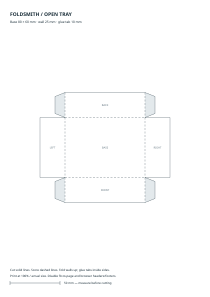

# Foldsmith

**Turn measurements into paper you can fold.**

Foldsmith generates printable SVG patterns for open-top paper trays. It is for
people making desk organizers, board-game component trays, or small craft boxes
who want to choose the dimensions rather than resize a fixed template.

This is a new, early-stage project. Version 0.1 supports one shape: an open tray
with four tapered glue tabs. It is written in Python 3.11+ and has **no runtime
dependencies, accounts, network calls, or AI services**.



## Try it

```bash
git clone https://github.com/sameerdeolalikar/foldsmith.git
cd foldsmith
python3 -m foldsmith --width 80 --depth 60 --height 25 --output tray.svg
```

Open `tray.svg` in a browser or SVG editor. Select matching A4 paper, print at
**100% / actual size**, and disable fit-to-page and browser headers/footers.
Measure the printed **50 mm calibration line** before cutting. A printer or
application can still introduce scaling, even though the SVG uses physical units.

1. Cut the solid outer boundary.
2. Score the dashed lines.
3. Fold all four walls upward.
4. Fold the shaded tabs inward and glue them to the inside of the side walls.

Dimensions refer to the fold-line base and wall height. Paper thickness is not
compensated, so finished internal dimensions may be slightly smaller.

## Options

All measurements are in millimetres.

| Option | Meaning |
| --- | --- |
| `--width`, `--depth`, `--height` | Required base dimensions and wall height |
| `--tab 10` | Glue-tab width; cannot exceed wall height, and two tabs must fit within the depth |
| `--paper a4` | `a4`, `letter`, or a custom-sized sheet |
| `--orientation auto` | Try portrait, then landscape; alternatively require either orientation |
| `--output tray.svg` | Output file; existing files are protected |
| `--force` | Explicitly replace an existing output file |

```bash
# US Letter sheet
python3 -m foldsmith --width 90 --depth 65 --height 30 --paper letter -o letter.svg

# A larger pattern for a suitable printer or SVG editor
python3 -m foldsmith --width 300 --depth 200 --height 40 --paper custom -o large.svg
```

An oversized pattern is rejected rather than silently reduced. Custom paper uses
auto orientation and produces one sheet; it does **not** tile a pattern across
standard pages. There is no PDF exporter yet.

For an installed `foldsmith` command, optionally run:

```bash
python3 -m venv .venv
. .venv/bin/activate
python -m pip install .
foldsmith --width 80 --depth 60 --height 25 -o tray.svg
```

The package is installed from this checkout, not from a published PyPI release.

## Development

```bash
python3 -m unittest discover -s tests -v
```

Tests cover the closed cut perimeter, shared fold edges, fractional dimensions,
invalid inputs, physical SVG units, page fitting, and output-file protection.
GitHub Actions also checks installation on Python 3.11–3.13.

- `foldsmith/geometry.py`: physical net and edge classification.
- `foldsmith/svg.py`: sheet fitting, print instructions, and SVG rendering.
- `foldsmith/cli.py`: command-line validation and file output.
- `examples/`: reproducible generated patterns, with no external assets.

Physical assembly and printer calibration still need real-world validation.
See [ROADMAP.md](ROADMAP.md) for planned work and [CONTRIBUTING.md](CONTRIBUTING.md)
for development conventions. Licensed under [MIT](LICENSE).
